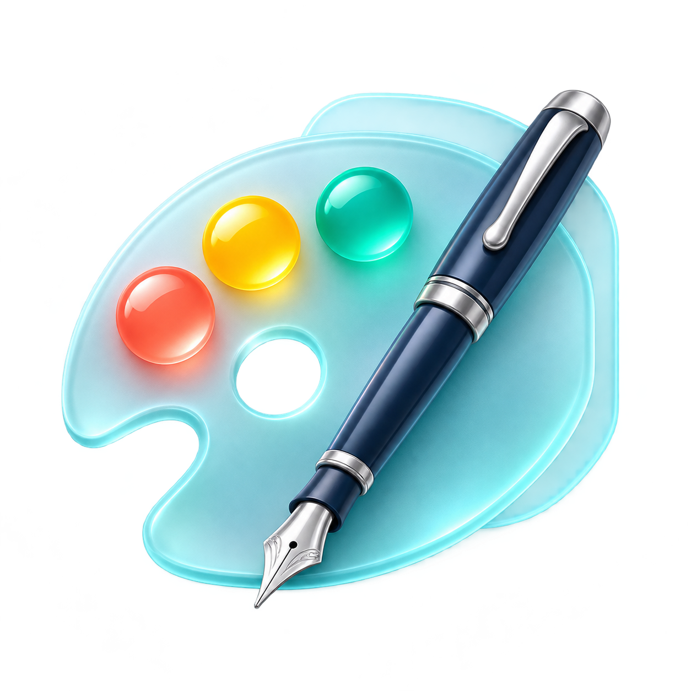
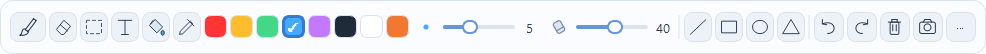

# Paint Overlay

<p align="center"></p>

Небольшое приложение для Windows: рисование поверх окон, фигуры и заметки без переключения в графический редактор.



Компактная белая панель высотой 54 px: кисть, ластик, выделение, текст, заливка, пипетка, цвета, размеры, фигуры и действия. Кнопка кисти открывает выбор типа. Остальные настройки доступны через **⋯**. Стекло и лента Paint убраны.

## Установка

Скачайте **Paint Overlay Setup.exe** из [Releases](https://github.com/qqracha/paint-overlay/releases). Мастер установки создаёт ярлыки и предлагает автозапуск (включён по умолчанию). Права администратора не нужны. Также доступен отдельный **Paint Overlay.exe** для запуска без установки. Python для готовой версии не требуется.

Перед обновлением закройте приложение через трей. Удаление — через список приложений Windows. Установщик обновляет прежний Just Pointer; настройки переносятся при первом запуске.

## Управление

| Действие | Управление |
| --- | --- |
| Включить / выключить слой | Ctrl+D или Ctrl+Alt+D |
| Кисть / ластик / выделение / текст | B / E / S / T |
| Рисовать выбранным инструментом | ЛКМ |
| Ластик | ПКМ |
| Маленькая палитра у курсора | Mouse3, только в слое |
| Отмена / повтор | Ctrl+Z / Ctrl+Shift+Z, включая удержание |
| Очистить рисунок | Ctrl+Alt+E |
| Сохранить PNG без панелей | Ctrl+Alt+S |
| Копировать / вырезать выделенное | Ctrl+C / Ctrl+X |
| Вставить выделенный фрагмент сразу | Ctrl+V |
| Выделить весь слой | Ctrl+A |
| Удалить выделенное | Delete |
| Снять выделение / выйти из слоя | Esc |

Линия с Shift привязывается к направлениям с шагом 45°. Прямоугольник с Shift становится квадратом, эллипс — кругом. Для выделения протяните рамку; внутри неё можно перемещать фрагмент, за углы — менять размер.

Capture снимает только монитор последнего рисования, копирует результат в буфер обмена и сохраняет PNG. Попап подтверждает сохранение. Перед снимком скрываются все окна приложения, включая меню и уведомления; на современных Windows они также временно исключаются из захвата средствами ОС. Панели и редактор не попадают в кадр. Если рисунка ещё нет, выбирается монитор курсора.

Скриншоты: `Изображения/Paint Overlay`. Настройки: `%LOCALAPPDATA%/Paint Overlay/settings.json`. Рисунок хранится в памяти до очистки или выхода.

## Инструменты

Кисть, ластик, текст, линия, прямоугольник, эллипс, треугольник, заливка связанной области, пипетка и прямоугольное выделение. Кнопка Brushes раскрывает сетку 3×3 с девятью типами штриха.

Текст: T → клик → ввод, шрифт, размер и жирность. Ctrl+Enter размещает текст на слое, Esc отменяет. Во время ввода буквенные хоткеи отключены, поэтому B/E/S/T вводятся как обычный текст.

Выделение: S → протянуть рамку. Внутри — перенос; маркеры по краям и углам — изменение размера. Клик снаружи снимает выделение или начинает новую рамку. Вставка сразу выделяется для переноса. Само создание рамки не расходует историю Undo. Меню **Size** регулирует независимые размеры кисти и ластика; **Outline / Fill** переключает контур и заливку фигур. Палитра Mouse3 автоматически скрывается при начале рисования.

Верхняя панель и палитра Mouse3 снова белые. Верхняя панель написана на Qt и перерисовывается при масштабировании: растянутого изображения панели в приложении нет. Компоновка вдохновлена классической лентой графических редакторов; приложение не связано с Microsoft Paint.

## Запуск из исходников

Windows 10/11 x64, Python 3.10 или новее:

```powershell
python -m venv .venv
.venv/Scripts/python.exe -m pip install -r requirements.txt
.venv/Scripts/python.exe src/paint_overlay.py
```

## Сборка

Установите Inno Setup 6 и выполните:

```powershell
./build.ps1
# При нестандартной установке компилятора:
./build.ps1 -InnoCompiler 'C:/path/to/ISCC.exe'
```

Результаты: `dist/Paint Overlay.exe` и `dist/Paint Overlay Setup.exe`.

```powershell
.venv/Scripts/python.exe -m unittest discover -s tests -v
```

## Ограничения

- Выделение, пипетка и заливка работают с рисунком на прозрачном слое, а не с окнами под ним.
- Обрезка, поворот, масштабирование холста и дополнительные фигуры пока недоступны; это указано в подсказках. Маркеры выделения меняют размер выбранного фрагмента.
- История Undo ограничена 20 действиями и бюджетом 128 МБ; на больших экранах действий меньше.
- Сохранения редактируемого проекта и восстановления рисунка после перезапуска пока нет.
- Сборки не подписаны цифровым сертификатом. Особые защищённые экраны и эксклюзивные полноэкранные приложения могут не поддерживать оверлей.

## Лицензия

MIT. Иконка создана для Paint Overlay; описание генерации находится в [docs/branding.md](docs/branding.md).

Шаблон GitHub Actions: ci/windows-checks.yml. Для включения автоматических проверок перенесите его в .github/workflows/checks.yml через учётную запись с доступом workflow.

В 2.3 обычная кисть обновляет только область штриха; неподвижный курсор не перерисовывает холст. Опрос мыши использует точный таймер.
